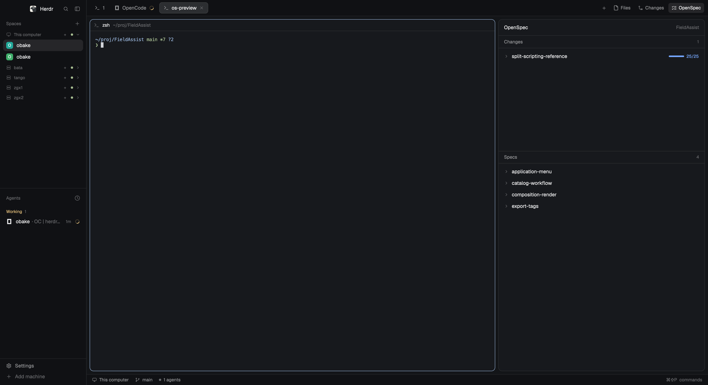

# OpenSpec Panel for Herdr

A side panel for [Herdr](https://herdr.dev) that shows the [OpenSpec](https://github.com/Fission-AI/OpenSpec) work in the repo you're in: the proposed changes, how far along each one is, and the specs they touch.



## What it does

- Lists every active change under `openspec/changes/` with its task completion as `done/total` (read from each change's `tasks.md`).
- Lists the capabilities under `openspec/specs/`.
- A draggable divider splits the two sections.
- Click a change or a spec to see the files it carries; click a file to read it inline with syntax highlighting.
- Follows the focused pane's folder, local or remote, so it tracks whatever repo you're working in.

It sits beside Herdr's own Files and Changes panels, with its own **OpenSpec** button in the tab bar.

## Install

Copy `layouts/` and `mods/` into your Herdr config folder:

```sh
cp -R layouts mods ~/.config/herdr-app/
```

Then switch to the **OpenSpec** layout with `ctrl-shift-l` (or `herdr-app do layout.switch '{"name":"main-openspec"}'`). Your existing `main` layout is left untouched.

## Notes

- Requires a Unix shell (`sh`, `find`, `sed`) on the machine the repo lives on.
- The layout and tab bar are copies of Herdr's shipped `main` layout and `tabs` mod, so they won't pick up future Herdr updates to those.
- `RECIPE.md` describes how it's built, if you want to rebuild or adapt it.
