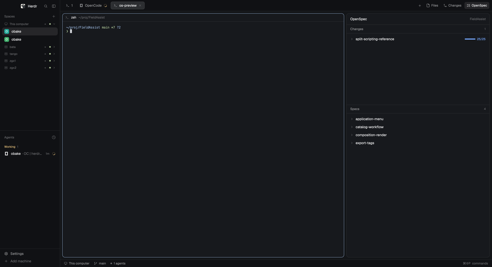

# OpenSpec Panel

A right-side panel for repos that use [OpenSpec](https://github.com/Fission-AI/OpenSpec): the top of the panel lists every proposed change under `openspec/changes/` with its task completion as `done/total`, the bottom lists the capabilities under `openspec/specs/`, and a draggable divider splits the two. Click a change to see its artifacts as a structured detail shaped by the project's schema (proposal, design, collapsible task sections, and a tree of the specs it touches for `spec-driven` projects); click a spec or any file to read it inline — Markdown renders as formatted prose, other files with syntax highlighting, the way the Files panel previews a file. It rides alongside Herdr's own Files and Changes panels with its own toggle button in the tab bar. Copy `layouts/` and `mods/` into `~/.config/herdr-app/`, then switch to the `main-openspec` layout (`ctrl-shift-l`).

## What you see

The panel is a card in the right-hand column, the same shape as Herdr's Files and Changes panels: rounded 10px, theme `background`, a 1px `border`, 13px text in the theme `foreground`, filling the column it is docked in (the layout gives it 368px wide, min 280, max 900).

- **Header, 42px:** the word "OpenSpec" in semibold on the left; on the right, dim 12px breadcrumbs of where you are (`repo / change / file`). A back arrow (20px wide, theme `muted`) appears once you are inside a change, a spec, or a file.
- **Changes section (top):** a 30px sub-header row — "Changes" in semibold `muted` 12px, a spacer, and the change count in `dim` 11px — over a scrolling list. Each change is a 30px row: a 12px chevron-right in `dim`, the change name (theme `foreground`, truncating), and a right-aligned completion badge. The badge is a 40px progress bar over a `raised` track — fill `done` when every task is checked, else `accent`, minimum 2px — plus `done/total` in 11px (`done` when complete, else `muted`); a change with no `tasks.md` shows a `—`.
- **Divider:** a draggable horizontal handle between the two sections.
- **Specs section (bottom):** the same 30px sub-header — "Specs" and the spec count — over a scrolling list of the capabilities in `openspec/specs/`, each a 30px row with a chevron-right and the name.
- **Detail view** (after opening a change): a 42px strip at the top showing the change name in semibold with the overall task badge behind it (the same progress bar/`done/total` as the list). Below it, the change's own documents — `proposal.md` and `design.md` — appear directly as two file lines (no headers), each rendering inline on click; a missing one shows a dim "No proposal"/"No design". The **Tasks** section then gets its own full-width band like the change strip (a `Tasks` label; the change strip up top already shows the completion badge, so the band itself stays label-only), under which tasks.md is parsed into its `##` groups: every group is a collapsible 28px header (chevron down when open, right when closed) showing the group title and its `done/total` in 11px (`done` green when complete), and opening it lists the checkbox tasks as 24px rows — `✓` in `done` (description dim) for a checked box, `○` in `muted` (description `foreground`) for an open one; a `## Workflow follow-up` group carries no tasks. The **Specs** section follows with a similar full-width band (`Specs` and the spec count), drawing the change's `specs/<capability-path>/spec.md` files as the same folder/file tree as before. This structured layout is the `spec-driven` view (read from `openspec/config.yaml`, falling back to the change's `.openspec.yaml` and then the `spec-driven` default, like the CLI); any other configured schema shows the change's plain files tree, as before. Clicking a spec (from a spec row) still opens its plain files tree. Folders toggle with a chevron, files preview inline (Markdown as rendered prose, others as text), and the back arrow steps out the same way. Opening a change or spec draws the header strip (change name + badge) immediately, then the content appears when it is ready — nothing for the first 100 ms (so a fast load never flashes placeholders), a native spinner after that, then the real view.
- **File view:** a Markdown file (`.md`, `.markdown`, `.mdx`) is rendered as formatted prose by the kit's `TextView.markdown` — headings, bullet and ordered lists, block quotes, fenced code blocks with a language label, tables, task checkboxes, and links, selectable and scrolling inside a padded 13px theme-`foreground` column. Every other file is drawn by the kit's read-only `Editor` — line numbers, folding, and syntax colors from the theme (`ansi5` keywords, `ansi2` strings, `dim` comments, `ansi4` functions, `ansi3` types, `ansi1` numbers, `ansi6` constants), 12px mono. Binary files (a NUL byte) and unreadable files show a dim message instead.

Everything follows `theme()`, so it matches the person's light or dark appearance. Rows highlight on hover with `hover`; the file being viewed sits on `selected`.

## How it behaves

- **Which repo:** it uses the focused pane's folder on that pane's machine, exactly like the Files and Changes panels (`focused().pane` → `panes()[i].cwd`, falling back to `focused().cwd` and the active space's folder). It then walks up from that folder to the nearest `openspec/changes`, so it works from a subdirectory or a nested repo.
- **Changes:** the immediate subfolders of `openspec/changes/`, with `archive/` and dotfolders skipped. Each change's completion comes from its `tasks.md`: a line counts when it matches `^\s*[-*]\s*\[([ xX])\]`; `[x]`/`[X]` are complete, `[ ]` is not. Wrapped task lines still have exactly one checkbox line, so only those count.
- **Specs:** the immediate subfolders of `openspec/specs/`.
- **Clicks:** a change or spec row opens its detail view; a folder row toggles open/closed; a file row previews the file; the back arrow steps out one level at a time (file → item → the two-section list). The panel never writes anything.
- **The divider:** drag it to resize the two sections; the size is kept by the window under the id `openspec-split` and survives repaints (it resets when the window closes). The top section starts at 300px, each section has an 80px minimum.
- **Live updates:** while the panel is local, it watches the `openspec/` folder and refreshes when anything under it changes; there is also a 10-second fallback timer (remote folders only get the timer). The open change, spec, and file stay put across refreshes, and are dropped if the folder moves to another repo.
- No agent-status colors are used; the panel shows none of Herdr's working/blocked/done/idle states.

## Built from

One layout and two mods, plus Herdr's shipped mods.

- **`layouts/main-openspec.json`** — a clone of Herdr's `main` layout (`cloned_from: {name: "main"}`), so it keeps the spaces/agents sidebar (`spaces`, `agents`, `workspace-chrome` in a 46px brand bar and a 69px footer), the 42px tab bar, the tab block with a `pane` frame (radius 10, `border`, `focus` `accent`, a 30px `pane` header), the 28px `workspace-status` bar, and the right panel column (368px, hidden by default). Two changes from `main`:
  - the `panel-body` stack gains a third child, `{ "id": "openspec", "content": { "mod": "openspec" } }`, after `files` and `changes`;
  - the `tabs` block points at `tabs-openspec` instead of Herdr's `tabs`.
- **`mods/openspec/`** — `main.js` (a `View`), `mod.json` `{ "place": "none" }` (it is only where the layout puts it), and five icons: `openspec.svg` (a list-checks glyph for the tab button), `chevron-down.svg`, `chevron-right.svg`, `file.svg`, `folder.svg`. No `props`.
- **`mods/tabs-openspec/`** — a clone of Herdr's `tabs` mod (`cloned_from: {name: "tabs", version: "0.1.15"}`) with its Windows title-bar icons copied in. One change from `tabs`: it always offers an OpenSpec panel button (`panelButton("openspec", "OpenSpec", "mods/openspec/openspec.svg")`) by appending `"openspec"` to the `workspace.panels` list it reads, so the per-space panel memory and the button both include it.
- **`herdr` functions the mod calls:** `spaces`, `panes`, `focused`, `theme`, `settings`, `exec`, `readTextFile`, `watchFolder`. It calls no commands (`run`) and opens no overlays.
- **Programs it runs:** `sh -c` scripts through `exec` — one that walks up from the pane's folder to `openspec/changes`, one that lists a folder's subfolders, and one that lists a folder's files (`find . -type f ! -name '.*' | sed 's|^\./||' | sort`). Completion counts and file previews are read with `readTextFile`. `on` is passed through, so the same scripts run on a remote space's machine.
- **Art:** the five SVGs above; everything else is theme colors and the kit's `Editor`, `TextView`, `v_resizable`, `resizable_panel`, `h_flex`, `v_flex`.

## Watch out

- **Unix only.** The scripts use `sh`, `dirname`, `find`, `sed`, and `sort`. On a Windows machine (local or remote) `exec("sh", …)` fails and the panel shows an error instead of a list. The Files panel's PowerShell fallback was not ported.
- The two mods are **clones of Herdr's shipped `main` layout and `tabs` mod**, so they do not pick up future Herdr updates to those. Re-clone if Herdr changes them.
- **`.openspec.yaml` is hidden** (all dotfiles are), and `archive/` is excluded from the changes list by name. A repo whose OpenSpec layout differs (changes not under `openspec/changes`) will read as "No OpenSpec folder in this repo".
- The folder walk starts at the focused pane's folder; a pane in an unrelated folder shows the empty message. There is no repo picker.
- File previews cap the text at 400,000 characters (appending "… (file truncated)") and detect binary by a NUL byte; there is no per-line cap.
- Markdown rendering is the kit's `TextView.markdown`: it does not load images (an `` leaves a blank gap), gives fenced code blocks no per-language syntax colors, and links use `TextView`'s default URL handling rather than an in-panel jump — a relative link in a document does not navigate the panel.
- The divider position is window state, not saved to disk, so it returns to 300px on the next launch.
- `mod.json` uses `"place": "none"`, so nothing docks it on its own — it appears only through `main-openspec`. Opening the layout with Herdr's own `main` will not show it.

## Done when

- `herdr-app check ~/.config/herdr-app/mods/openspec` and `herdr-app check ~/.config/herdr-app/mods/tabs-openspec` both pass.
- `herdr-app status` reports no errors after `layout.switch {name: "main-openspec"}`, and the tab bar shows a **Files**, a **Changes**, and an **OpenSpec** button.
- With a pane focused in a repo that has `openspec/`, the OpenSpec button opens a panel whose top section lists that repo's active changes (each with `done/total`) and whose bottom section lists its specs; a repo with no `openspec/` shows "No OpenSpec folder in this repo".
- Dragging the divider moves the boundary between the two sections.
- In a `spec-driven` repo (default), clicking a change shows its Proposal and Design line items, its Tasks as collapsible `##` groups with `done/total` per group (a group collapses and expands), and a Specs tree of the change's `specs/<capability>/spec.md` files. Clicking a proposal, design, or spec file opens it inline rendered as Markdown (headings, lists, tables, checkboxes); any non-Markdown file opens in the syntax-highlighted editor; the back arrow returns to the change, then to the two-section list. Clicking a spec shows its `spec.md` the same way.
